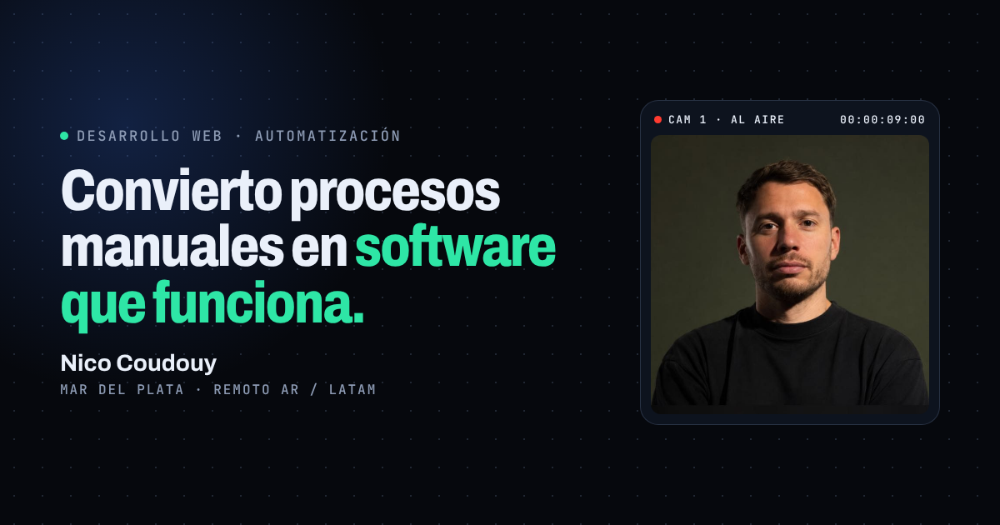

# Nico Coudouy · Landing personal

Portfolio de **Nicolás Coudouy**: desarrollo web y automatización, con 9 años de experiencia en televisión en vivo en Canal 8 Mar del Plata.

🔗 **Sitio:** [mylandingpage-one.vercel.app](https://mylandingpage-one.vercel.app)



## Qué incluye

- **Proyectos como casos:** problema, solución, resultado y stack, con video y capturas reales. Filtros por Web, Automatización, Broadcast y Audiovisual.
  - Teleocho Informa (Canal 8): paquete gráfico del noticiero generado con código.
  - Florencia Ferraro Propiedades: web para una inmobiliaria.
  - Automatizaciones para Canal 8: escáner del archivo de video y rundowns de Airtable a Squid CGX.
  - Tiza: app de reservas para gimnasios.
  - Festival Internacional de Cine de Mar del Plata: edición para redes.
  - LiveRundown: proyecto en desarrollo.
- **Asistente con IA:** chat que responde sobre mi perfil con Llama 3.3 vía Groq, con límite de uso por visitante y por día.
- **Microinteracciones:** campo de puntos que reacciona al mouse, monitor de cámara con timecode en vivo, consola que tipea comandos y navegador que recorre una web.
- **Accesible y liviano:** respeta `prefers-reduced-motion`, los videos se pausan fuera de pantalla y no usa librerías de UI.

## Stack

- React 19 + TypeScript + Vite
- CSS propio, sin frameworks
- Vercel Functions (`api/chat.ts`) para el asistente
- Groq (Llama 3.3 70B) como modelo, con un proveedor de respaldo opcional
- Upstash Redis + `@upstash/ratelimit` para los límites de uso
- Vercel Analytics

## Cómo funciona el límite del asistente

`api/chat.ts` aplica estas reglas antes de llamar al modelo:

| Regla | Valor |
|---|---|
| Preguntas por visitante (IP) | 10 por día |
| Preguntas totales del sitio | 300 por día |
| Largo máximo de una pregunta | 500 caracteres |
| Mensajes de contexto enviados | últimos 8 |
| Largo máximo de la respuesta | 350 tokens |

Además, solo responde a pedidos que vienen del propio dominio, nunca expone la clave de la API y devuelve mensajes amables cuando hay un error o se llega al límite.

Si Upstash no está configurado, usa un contador en memoria por instancia como respaldo. Sirve para frenar abusos casuales, pero se reinicia en cada arranque en frío, así que en producción conviene configurar Upstash.

## Variables de entorno

Copiá `.env.example` a `.env.local` para desarrollo, o cargalas en Vercel:

| Variable | Obligatoria | Para qué |
|---|---|---|
| `GROQ_API_KEY` | Sí | Clave de [Groq](https://console.groq.com/keys) |
| `KV_REST_API_URL` y `KV_REST_API_TOKEN` | Recomendada | Las crea Vercel al conectar Upstash Redis desde el Marketplace. También acepta `UPSTASH_REDIS_REST_URL` y `UPSTASH_REDIS_REST_TOKEN`. |
| `GROQ_MODEL` | No | Cambia el modelo de Groq (por defecto `llama-3.3-70b-versatile`) |
| `FALLBACK_API_URL`, `FALLBACK_API_KEY`, `FALLBACK_MODEL` | No | Proveedor de respaldo compatible con la API de OpenAI (Cerebras, Gemini, etc.) |
| `ALLOWED_ORIGINS` | No | Dominios extra habilitados, separados por coma (por ejemplo, un dominio propio) |

## Desarrollo local

Requiere Node.js 18 o superior.

```bash
npm install
npm run dev        # solo el frontend, en http://localhost:3000
npx vercel dev     # frontend + función del asistente
```

```bash
npm run lint       # chequeo de tipos
npm run build      # build de producción en dist/
```

## Estructura

```
.
├── api/chat.ts              # Asistente: límites, validación y llamada al modelo
├── public/
│   ├── assets/              # Videos, capturas, foto y CV
│   └── og-image.png         # Imagen para compartir en redes
└── src/
    ├── components/          # Secciones de la página
    │   └── projects/        # Medios interactivos de cada proyecto
    ├── data/                # Proyectos y datos de contacto
    ├── hooks/               # useReducedMotion
    ├── lib/chat.ts          # Cliente del asistente
    ├── App.tsx
    └── index.css
```

## Autor

**Nicolás Coudouy** · Mar del Plata, Argentina
[LinkedIn](https://www.linkedin.com/in/nicocoudouy) · [GitHub](https://github.com/nico-coudouy) · nicocoudouy@gmail.com
